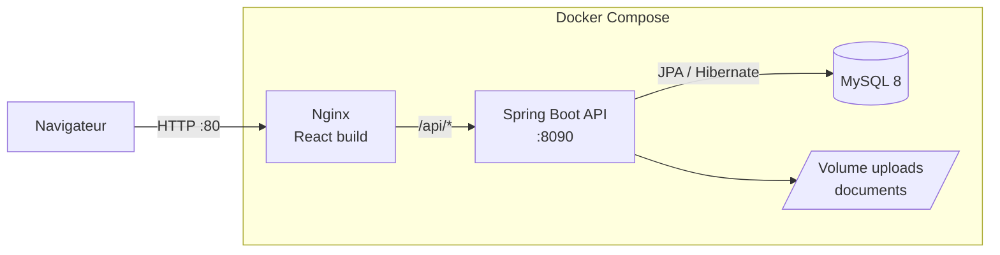

# GMAO — Gestion de Maintenance Assistée par Ordinateur

Application web complète de **gestion de la maintenance industrielle** : suivi des équipements par usine, ordres de travail, plans de maintenance préventive, stock de pièces de rechange, fournisseurs et bons de commande. Elle fonctionne avec des espaces dédiés selon le rôle de chaque utilisateur.


---

## Sommaire

- [Fonctionnalités](#fonctionnalités)
- [Rôles et espaces](#rôles-et-espaces)
- [Architecture](#architecture)
- [Stack technique](#stack-technique)
- [Structure du projet](#structure-du-projet)
- [Lancer le projet](#lancer-le-projet)
- [Déploiement et CI/CD](#déploiement-et-cicd)
- [API REST](#api-rest)
- [Captures d'écran](#captures-décran)

---

## Fonctionnalités

**Patrimoine**
- Gestion multi-usines et des équipements rattachés (fiche détaillée, documents joints)
- Classement par tags et groupes de tags, centres de coûts
- Points de mesure et unités (compteurs, relevés)

**Maintenance**
- Ordres de travail (tâches) avec cycle de vie : `CREATED → PLANNED → IN_PROGRESS → DONE`, plus les états `LATE`, `CANCELED` et `ARCHIVED`
- Activités d'intervention : intervenants, pièces consommées, relevés de mesures, coûts additionnels, pièces jointes
- **Plans de maintenance préventive** avec quatre déclencheurs : date fixe, clôture d'une tâche, compteur, ou API externe
- **Génération automatique des tâches** chaque nuit par une tâche planifiée Spring (`@Scheduled`)
- Vue calendrier des plans de maintenance

**Stock et achats**
- Pièces de rechange : stock, historique des mouvements, alerte de stock bas
- Fournisseurs et catalogue fournisseurs importable (CSV / Excel)
- Bons de commande avec lignes et suivi de statut

**Collaboration**
- Équipes, invitation de collègues, gestion des utilisateurs
- Notifications : tâche assignée, changement de statut, stock bas, plan échu, etc.
- Tableaux de bord par rôle et export de données en Excel

## Rôles et espaces

L'authentification repose sur **JWT** et l'accès est contrôlé par rôle, côté API comme côté interface.

| Rôle | Espace | Usage principal |
|---|---|---|
| `SUPERADMIN` / `ADMIN` | Administration | Configuration complète : usines, équipements, stock, achats, utilisateurs |
| `SUPERVISOR` | Administration | Pilotage et supervision des interventions |
| `TECHNICIAN` | Technicien | Réalisation des tâches, saisie des activités, plans assignés |
| `PRODUCTION` | Opérateur | Déclaration de pannes et suivi des demandes |
| `SERVICE_PROVIDER` | Prestataire | Interventions externes sur les tâches et plans confiés |

Un compte `SUPERADMIN` est créé automatiquement au premier démarrage.

## Architecture



Le frontend est servi par **Nginx**, qui fait aussi reverse proxy vers l'API. Le front et le back partagent donc la même origine, sans configuration CORS en production.

## Stack technique

| Couche | Technologies |
|---|---|
| Backend | Java 17, Spring Boot 3.5 (Web, Data JPA, Security, Validation), JWT (jjwt), Lombok, Maven |
| Frontend | React 19, TypeScript, Vite, React Router 7, Axios, lucide-react, SheetJS (xlsx) |
| Base de données | MySQL 8 |
| Conteneurs | Docker (builds multi-étapes), Docker Compose |
| Infrastructure | Terraform sur Microsoft Azure (VNet, NSG, IP publique, VM Ubuntu 24.04 + cloud-init) |
| CI/CD | GitHub Actions : tests, build des images, push sur Docker Hub, déploiement SSH |

## Structure du projet

```
gmao/
├── gmao-backend/            # API REST Spring Boot
│   └── src/main/java/gmao_backend/
│       ├── auth/ security/  # Authentification JWT
│       ├── usine/ equipement/ tag/ costcenter/
│       ├── task/ activity/ maintenanceplan/
│       ├── sparepart/ supplier/ suppliercatalog/ purchaseorder/
│       ├── measure/ unit/ team/ user/ notification/
│       └── storage/ common/ config/ exception/
├── gmao-frontend/           # Application React + TypeScript
│   └── src/
│       ├── pages/           # admin/ technician/ operator/ provider/ common/
│       ├── layouts/         # Un layout par espace utilisateur
│       ├── services/        # Appels API (Axios)
│       ├── components/  types/  hooks/  utils/
├── infra/                   # Terraform (Azure) + cloud-init
├── docs/samples/            # Exemple de catalogue fournisseurs à importer
├── .github/workflows/ci.yml # Pipeline CI/CD
├── docker-compose.yml       # Lancement local (build des images)
└── docker-compose.prod.yml  # Production (images Docker Hub)
```

## Lancer le projet

### Option 1 : avec Docker (recommandé)

Prérequis : Docker et Docker Compose.

```bash
git clone <url-du-depot>
cd gmao
cp .env.example .env        # puis renseigner les valeurs
docker compose up --build
```

L'application est disponible sur **http://localhost**.

### Option 2 : en local, sans Docker

Prérequis : Java 17, Node.js 20 et une base MySQL 8 accessible.

**Backend**
```bash
cd gmao-backend
# Variables attendues : DB_URL, DB_PASSWORD, JWT_SECRET, SUPERADMIN_PASSWORD
./mvnw spring-boot:run      # API sur http://localhost:8090
```

**Frontend**
```bash
cd gmao-frontend
npm install
echo "VITE_BACKEND_URL=http://localhost:8090" > .env.local
npm run dev                 # http://localhost:5173
```

### Variables d'environnement

| Variable | Description |
|---|---|
| `DB_PASSWORD` | Mot de passe de l'utilisateur MySQL `gmao_user` |
| `DB_ROOT_PASSWORD` | Mot de passe root MySQL (Docker uniquement) |
| `JWT_SECRET` | Clé de signature des jetons JWT (32 caractères minimum) |
| `SUPERADMIN_PASSWORD` | Mot de passe du compte super-admin créé au démarrage |

## Déploiement et CI/CD

À chaque `push` sur `main`, le pipeline GitHub Actions :

1. **compile et teste le backend** (`mvn verify`) avec un service MySQL ;
2. **construit le frontend** (`npm ci && npm run build`) ;
3. **construit et publie les images Docker** du backend et du frontend sur Docker Hub ;
4. **déploie sur la VM Azure** via SSH (`docker compose pull && up -d`).

L'infrastructure Azure est décrite en Terraform dans [`infra/`](infra) : groupe de ressources, réseau virtuel, pare-feu (ports 22 et 80), IP publique statique et VM Ubuntu configurée par cloud-init.

```bash
cd infra
terraform init
terraform apply
```

## API REST

Toutes les routes sont préfixées par `/api` et protégées par JWT, sauf l'authentification.

| Ressource | Route |
|---|---|
| Authentification | `/api/auth` |
| Usines / Équipements | `/api/usines`, `/api/equipment` |
| Tâches / Plans de maintenance | `/api/tasks`, `/api/maintenance-plans` |
| Pièces de rechange | `/api/spare-parts` |
| Fournisseurs / Catalogue | `/api/suppliers`, `/api/supplier-catalog` |
| Bons de commande | `/api/purchase-orders` |
| Mesures / Unités | `/api/measures`, `/api/units` |
| Tags / Centres de coûts | `/api/tags`, `/api/tag-groups`, `/api/cost-centers` |
| Utilisateurs / Équipes | `/api/users`, `/api/teams` |
| Notifications | `/api/notifications` |


## Auteur

**Aya Nasser** — [LinkedIn](https://www.linkedin.com/in/aya-nasser-ensias/) 
